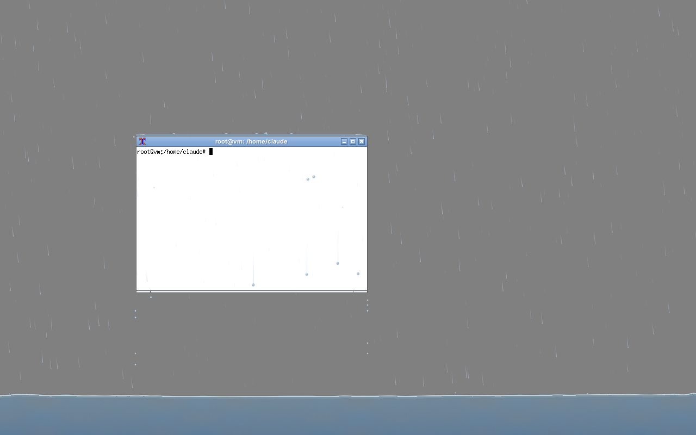
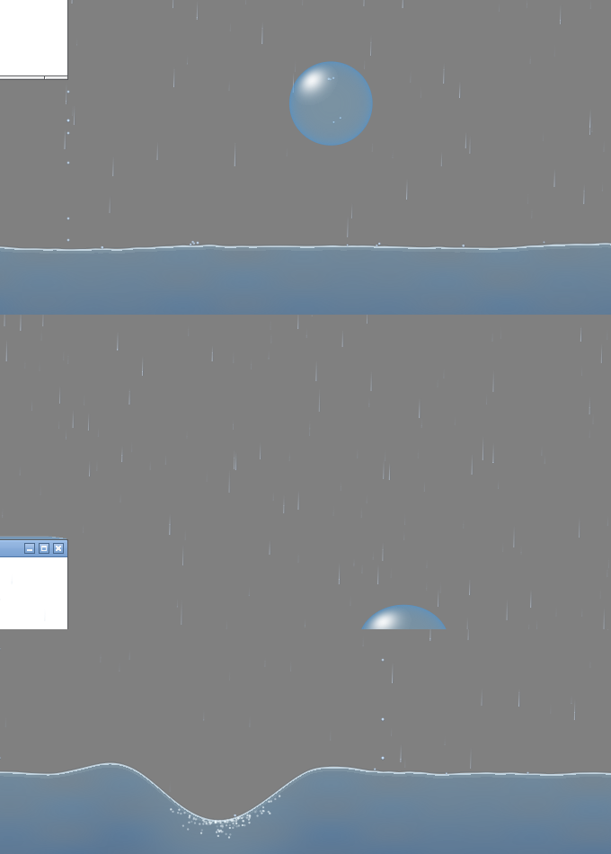

# SnowDesk ❄

[English](README.md) | **Русский**

Снег на рабочем столе Windows и Linux. Снежинки падают поверх экрана и копятся на верхних краях окон.
Если закрыть, свернуть или сдвинуть окно, снег с него осыпается вниз, на панель задач.
Снег можно собирать, лепить из него снежки, бросать их и складывать снеговика.

Есть и режим **дождя** (меню в трее → **Погода → Дождь**), подробнее [ниже](#дождь).

## Запуск

1. **[⬇ Скачать SnowDesk.exe](https://github.com/nyellswag/SnowDesk/raw/main/download/SnowDesk.exe)** (один файл, ~390 КБ, Windows 10/11). Положите его в любую папку и запустите двойным щелчком.
   Если программа лежит на диске C:, а у вас есть диск D:, она один раз предложит переехать в `D:\SnowDesk`.
2. Windows может предупредить: «Windows защитила ваш компьютер». У программы нет платной цифровой подписи,
   поэтому нажмите **Подробнее → Выполнить в любом случае**.
3. Справа внизу, у часов, появится значок-снежинка. Если его не видно, он может быть спрятан под стрелкой ^.

## Управление

Снег интерактивен всегда. Для этого не нужен отдельный режим, и обычной работе он не мешает.

| Действие | Как |
|---|---|
| Слепить снежок | зажмите левую кнопку мыши на сугробе (на земле или на окне) и поводите мышью |
| Бросить снежок | отпустите кнопку с размахом; о окно или землю снежок разобьётся |
| Положить снежок | отпустите плавно; три шара друг на друге становятся снеговиком |
| Толкать снег | снежинки огибают курсор; резкий взмах мышью пропахивает сугробы и пинает снежки |
| Кликнуть сквозь снег | короткий клик по сугробу без движения мыши уходит окну под снегом, как обычно |
| Режим игры | **Ctrl+Alt+S** или левый клик по снежинке у часов: мышь играет только со снегом, даже на пустом месте. Сверху появляется маленькая надпись «Play Mode». Выход: Esc, правая кнопка мыши или Ctrl+Alt+S |
| Меню | правый клик по снежинке у часов |

Окна твёрдые: снежок, брошенный в окно, разбивается о ту сторону, в которую попал, и снег отскакивает и падает вниз. Плавно опущенный снежок может лежать на верхнем краю окна, и там тоже можно слепить снеговика. Снеговик едет вместе с окном, если перетаскивать его плавно, и падает, если окно резко дёрнуть, свернуть или закрыть. Брошенный снег не остаётся острой кучей: он скатывается и рассыпается в пологий холмик. Курсор толкает снег, только если резко махнуть мышью, поэтому, когда вы спокойно подводите его к сугробу или снежку, чтобы схватить, снег остаётся на месте.

Пункты меню: режим игры, пауза, сила снегопада (лёгкий, обычный, сильный, метель),
«Насыпать сугроб», «Убрать весь снег», **«Лепить снежки без режима игры»** и **«Курсор толкает снег»**
(оба включены по умолчанию, любой можно выключить), автозапуск, «Открыть папку программы»,
**язык** (английский или русский), **«Удалить SnowDesk полностью»**, выход.
По умолчанию интерфейс на английском. Переключить его на русский можно в меню у часов: **Language / Язык → Русский**.

В полноэкранных играх и видео снег прячется сам.

## Дождь



Выберите в меню у часов **Погода → Дождь** (снег и вода сохраняются отдельно, вернуться можно в любой момент).

- Капли падают по ветру и разбиваются брызгами о верх окон, о курсор и о воду.
- Окна мокнут: на стекле появляются капли и стекают вниз, на верхнем крае копится вода и струйками бежит по бокам.
  Если закрыть, свернуть или потрясти окно, вода с него выливается.
- Внизу экрана собирается вода с настоящими волнами. Она медленно поднимается максимум примерно до шестой части экрана
  и понемногу уходит сама. Вода прозрачная, клики проходят сквозь неё, панель задач работает.
- **Водяной шар:** зажмите мышь в воде, шар растёт, а уровень воды падает. Бросьте его, и он разобьётся об окно,
  край экрана или воду. Большая часть воды превращается в брызги и исчезает, обратно возвращается примерно четверть.
- **Водоворот:** быстро помешайте воду курсором по кругу; через несколько секунд после остановки он затихает.
- «Устроить ливень» запускает короткий ливень, «Слить воду» опустошает бассейн.



## Linux

1. **[⬇ Скачать snowdesk-linux-x86_64.tar.gz](https://github.com/nyellswag/SnowDesk/raw/main/download/snowdesk-linux-x86_64.tar.gz)** (примерно 300 КБ).
2. Распакуйте архив и запустите программу:
   ```sh
   tar xzf snowdesk-linux-x86_64.tar.gz
   ./snowdesk/snowdesk
   ```
3. Один раз откроется меню с приветствием. Потом меню открывается сочетанием **Ctrl+Alt+M**, через значок в трее
   (там, где он есть: KDE, Xfce, Cinnamon, MATE) или повторным запуском `snowdesk`.
   **Ctrl+Alt+S** включает и выключает режим игры.

Снег, снежки, окна и меню работают так же, как на Windows.

- **В X11 работает всё:** KDE Plasma (X11), Xfce, Cinnamon, MATE и GNOME на Xorg.
- **Нужен композитор**, чтобы снег был прозрачным. В GNOME, KDE и Cinnamon он включён по умолчанию; в Xfce его включают
  в «Настройки → Тонкая настройка диспетчера окон → Композитор».
- **Wayland** (по умолчанию в новых Ubuntu и Fedora): SnowDesk работает через XWayland, но Wayland не даёт программам видеть
  чужие окна. Снег идёт и копится внизу экрана, но на окнах не лежит.
  Чтобы получить всё, выберите на экране входа «GNOME на Xorg» или «Plasma (X11)».
- **Требования:** 64-битный компьютер с glibc 2.27 или новее (Ubuntu 18.04+, Debian 10+, Fedora 28+ и подобные)
  и обычные библиотеки X11, которые есть на любом рабочем столе.
- **Файлы:** настройки хранятся в `~/.config/snowdesk/`, сохранённый снег в `~/.local/share/snowdesk/`, автозапуск (если включить)
  в `~/.config/autostart/snowdesk.desktop`. Пункт меню «Удалить SnowDesk полностью» стирает всё это и сам файл программы.
- **Командная строка:** `snowdesk --menu`, `snowdesk --play`, `snowdesk --quit`.

## Где хранятся данные (Windows)

Всё лежит рядом с `SnowDesk.exe`: `SnowDesk.ini` с настройками и `snow.dat` с сохранённым снегом и снеговиками.
Ярлыков и установщика нет, системные файлы программа не трогает.
Единственная запись в реестре появляется, только если вы сами включите автозапуск
(`HKCU\...\CurrentVersion\Run\SnowDesk`).

## Удаление

Меню → «Удалить SnowDesk полностью…» → «Да». Программа закроется, уберёт свой автозапуск
и сотрёт свои файлы и свою папку. Чужие файлы она не трогает: папка удаляется,
только если она называется `SnowDesk` и в ней не осталось других файлов.

## Нагрузка (оценка для экрана 1920×1080)

- Оперативная память: примерно 15–30 МБ, пока программа запущена (на 4K-экране около 45 МБ). После выхода 0.
- Процессор: около 1–3%, обновление 30 кадров в секунду. В режиме игры 60 кадров в секунду и немного больше нагрузки.
  На паузе и в полноэкранных приложениях почти 0.
- Размер программы: около 330 КБ, один файл без зависимостей.

## Сборка из исходников

Код на C++17 и WinAPI, без сторонних библиотек.

- `src/sim.cpp`, `src/sim.h`: симуляция снега, не зависящая от Windows
- `src/main.cpp`: версия для Windows: окно-оверлей, значок у часов, меню, автозапуск, перенос на D:, самоудаление
- `src/linux/main_linux.cpp`: версия для Linux (X11): оверлей, пропуск кликов сквозь снег, значок в трее, меню, горячие клавиши, автозапуск, самоудаление
- `build.sh`: сборка версии для Windows через mingw-w64 (из Linux или из MSYS2 на Windows)
- `build_linux.sh`: сборка версии для Linux (нужны `libx11-dev libxext-dev libxrandr-dev libxft-dev libxtst-dev`)
- `tests/test_sim.cpp`: проверка симуляции без Windows, рисует кадры в файлы

```sh
./build.sh
```
